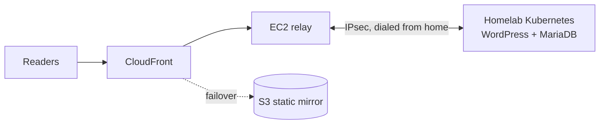
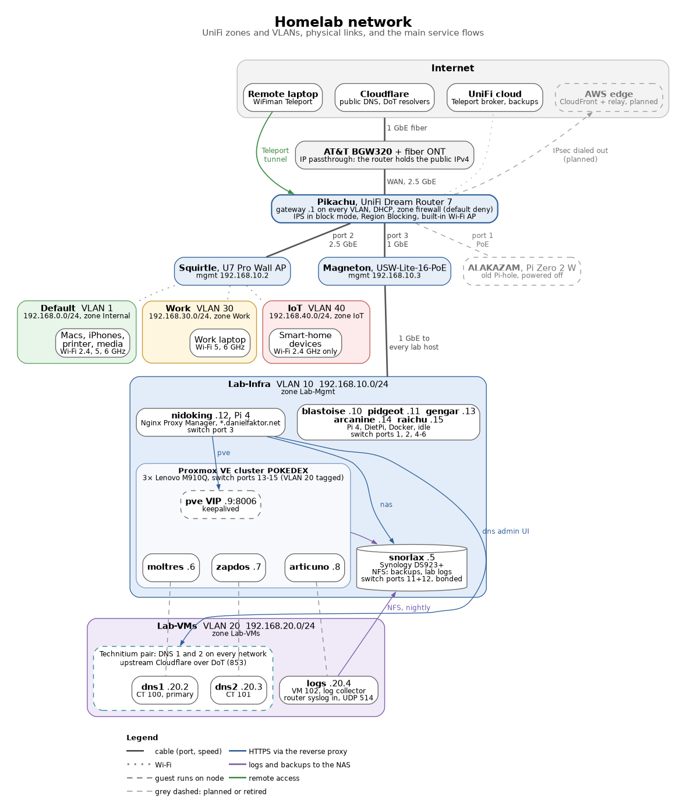

# lights-out-lab

A WordPress blog served from a three-node Kubernetes cluster in my homelab and published through Amazon CloudFront. It stays online when the lab goes dark.

The blog is the vehicle; the platform under it is the project. It shows a hybrid edge with no inbound ports at home, automatic failover to AWS, infrastructure built from code and GitOps, and an AWS Organization with guardrails, for about $8 a month. Later, an AI copilot will propose fixes as pull requests and act only after I approve them.

> Status: early. The design and the AWS guardrails are in place. The cluster and the public blog come next.

## How it works

- Readers only ever talk to CloudFront. It is the one public entry point.
- The home router dials out to a small relay in AWS over IPsec, so nothing at home accepts inbound connections.
- If the homelab errors or times out, CloudFront serves a static mirror of the site from S3.

## The homelab

- A UniFi Dream Router 7 sits behind AT&T fiber in IP passthrough. It splits the home into five VLANs, each its own firewall zone, with default deny between zones.
- Lab-Infra (VLAN 10) holds a three-node Proxmox VE cluster behind a keepalived virtual IP, a Synology NAS for backups and logs, and six Raspberry Pi 4s. One Pi runs Nginx Proxy Manager for internal HTTPS.
- Lab-VMs (VLAN 20) is where the Terraform in this repo builds guests: today a Technitium DNS pair that serves every network, and a log collector.
- Remote access is UniFi Teleport only. No ports are forwarded.

[Homelab network](docs/diagrams/homelab-network.md) has the address plan, the zone rules and every flow in the diagram.

## What's in this repo

| Path | Purpose |
| --- | --- |
| `docs/` | Design doc, architecture decision records, AWS guardrails, network diagram |
| `terraform/` | Proxmox VM module and Debian 13 templates; the AWS edge (planned) |
| `ansible/` | Node configuration and kubeadm (planned) |
| `kubernetes/` | Argo CD applications (planned) |
| `copilot/` | The AI copilot and its evals (planned) |

## Learn more

- [Design](docs/design.md): why it is shaped this way, and where the boundaries are
- [Decisions](docs/adr/): one record per significant decision
- [Homelab network](docs/diagrams/homelab-network.md): VLANs, firewall zones, cabling and service flows
- [AWS guardrails](docs/aws-guardrails.md): account layout and organization policies
- Build logs and deep dives: [blog.danielfaktor.com](https://blog.danielfaktor.com), once the blog is live
