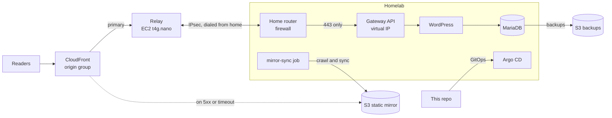

# Design: lights-out-lab

Accepted. Last updated Nov 16, 2026, by Daniel Faktor.

## Context and scope

I want to publish a real site, blog.danielfaktor.com, from a Kubernetes cluster in my homelab. A homelab is an unreliable origin: power, upgrades and experiments take it down. The home connection sits behind double NAT, and I don't want the home network listening on the internet at all. The design has to keep readers served through outages, cost little, and rebuild from code.

## Goals and non-goals

### Goals
- Readers get pages when the homelab is down.
- Nothing at home accepts inbound connections, and traffic from AWS enters through the home router's firewall.
- The platform rebuilds from Git in under an hour.
- Always-on AWS cost stays under $15 a month.

### Non-goals
- Comments or logins on the public site. It is read-only.
- High availability for the admin side. Writing a post can wait until the lab is back.
- Serving readers from EKS.

## Design

A request arrives at CloudFront, the only public entry point. CloudFront forwards it to a relay: one small EC2 instance that accepts web traffic only from CloudFront. The home router dials out to the relay over a site-to-site IPsec tunnel, and firewall rules let that tunnel reach only the cluster Gateway's virtual IP on port 443. The Gateway routes to WordPress, which stores its data in MariaDB.

A job in the cluster crawls the site and syncs a static copy to a private S3 bucket. CloudFront's origin group switches to that mirror when the relay returns a 5xx or doesn't answer within seconds. Argo CD deploys everything in the cluster from this repo. DNS for the blog's subdomain is delegated to Route 53.

## Failure and security model

- When the homelab is down, CloudFront serves cached pages stale first, then fails over to the S3 mirror. Only GET, HEAD and OPTIONS fail over, which is why the public site is read-only.
- Only CloudFront is public. The relay is the sole bridge, the home side starts the tunnel, and the tunnel can reach one address on one port.
- WordPress admin paths return 403 at the edge. They are reachable only from the home network or the router's remote-access VPN.
- Secrets and state never enter this repo. A `.gitignore` and a gitleaks pre-commit hook back that up.

The AWS side runs in an AWS Organization with Region, S3, EC2 metadata, audit and spend guardrails. See [AWS guardrails](aws-guardrails.md).

## Cost

About $8 a month always on, almost all of it the relay's instance and its public IPv4 address. CloudFront stays inside its free allowance. The on-demand EKS cluster is extra, at about $0.25 an hour while it runs.

## Decisions and alternatives

[ADR-001](adr/0001-blog-with-aws-failover.md) holds the full record. In short:

- Port forwarding with dynamic DNS is impractical behind double NAT, exposes the home address, and has no failover.
- AWS Site-to-Site VPN with a load balancer leaves nothing to patch, but costs about seven times as much.
- Cloudflare Tunnel is simple, but serves nothing when the origin is down.
- Hosting the blog in AWS is reliable, but the homelab stops being what readers use.

## Future phases

An AI copilot that proposes fixes as pull requests and acts only after I approve them, and an on-demand EKS cluster that hosts it. Each gets its own ADR.
