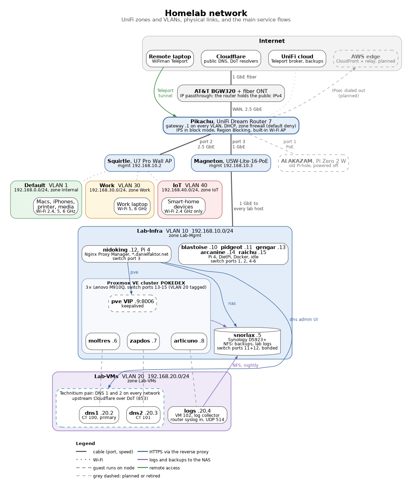

# Homelab network



The lab's network from the internet edge down to the guests on the Proxmox cluster: the five VLANs and their firewall zones, how each device is cabled, and the flows that cross zones. A scalable version is in [homelab-network.svg](./homelab-network.svg), and the source is [homelab-network.dot](./homelab-network.dot).

## Networks

| Network | VLAN | Subnet | Firewall zone | What lives there |
| --- | --- | --- | --- | --- |
| Default | 1 | 192.168.0.0/24 | Internal | Laptops, phones, printer, media devices |
| Lab-Infra | 10 | 192.168.10.0/24 | Lab-Mgmt | Proxmox nodes and VIP, NAS, Raspberry Pis, AP and switch management |
| Lab-VMs | 20 | 192.168.20.0/24 | Lab-VMs | Guests built by `terraform/`: the DNS pair and the log collector |
| Work | 30 | 192.168.30.0/24 | Work | A work laptop |
| IoT | 40 | 192.168.40.0/24 | IoT | Smart-home devices, on a 2.4 GHz-only SSID |

The gateway is `.1` on every VLAN. Infrastructure gets its address from a UniFi DHCP reservation, except the Proxmox nodes and their guests, which Proxmox sets itself. In Lab-Infra, addresses follow the switch ports: `.5` NAS, `.6`–`.8` Proxmox, `.9` the cluster VIP, `.10`–`.15` the Pis on ports 1–6.

## Who can talk to whom

Traffic between zones is denied unless a policy allows it, and replies to allowed traffic always pass.

- **Internal** reaches every zone except Work.
- **Lab-Mgmt** reaches Lab-VMs. Lab-VMs reaches Lab-Mgmt only through two policies for the log collector: NFS to the NAS and the Proxmox API ([ADR-005](../adr/0005-lab-log-collection.md)).
- **IoT** and **Work** get the internet and DNS on the Technitium pair, nothing else.
- **VPN** (UniFi Teleport clients) reaches Internal, Lab-Mgmt and Lab-VMs.
- IoT, Work and Lab-VMs can't reach the router's admin ports. IoT and Lab-VMs can't use DNS-over-TLS, except the DNS pair talking to Cloudflare.
- No port forwards, UPnP off. IPS runs in block mode, and Region Blocking applies to every network before any zone policy.

## Services and flows

- **DNS.** Every network hands out dns1 and dns2 as DNS 1 and 2 and its own gateway as DNS 3. The pair runs as Proxmox OCI containers on two different nodes, filters with blocklists, and forwards to Cloudflare over DNS-over-TLS ([ADR-004](../adr/0004-technitium-dns-pair.md)).
- **Internal HTTPS.** A DNS-only Cloudflare record points `*.danielfaktor.net` at nidoking. Nginx Proxy Manager there holds a wildcard Let's Encrypt certificate and proxies `pve` to the cluster VIP, `nas` to the Synology, and `dns` to dns1 with dns2 as a backup.
- **Proxmox.** Three nodes, each with one NVMe disk and one 1 GbE link trunked for VLANs 10 and 20. Guests live on node-local storage, and redundancy comes from the services ([ADR-002](../adr/0002-node-local-vm-storage.md)). Terraform and browsers use the keepalived VIP ([ADR-003](../adr/0003-terraform-proxmox-endpoint.md)). A nightly vzdump job backs the DNS containers up to the NAS.
- **Logs.** The router sends syslog to `logs`. Each night the collector pulls the DNS query logs and the Proxmox journals, then moves everything to the NAS over NFS ([ADR-005](../adr/0005-lab-log-collection.md)).
- **Remote access.** UniFi Teleport only. Clients land in the VPN zone.
- **Planned.** The router dials an IPsec tunnel out to a relay in AWS, so CloudFront can reach the blog with no inbound ports open at home. See the [design](../design.md).

## About this diagram

GraphViz fits this better than nwdiag, the usual choice for network topology. nwdiag lays every host out in one row per network, which would be about twenty boxes wide here. It also can't show flows between zones. GraphViz keeps the layout in vertical tiers (internet, ISP gateway, router, AP and switch, then the networks) and draws each firewall zone as a box.

- **Zone colors** follow trust: green for the trusted home LAN, amber for Work, red for IoT, blue for lab management, purple for lab guests.
- **Edge colors** carry meaning: thick dark lines are cables with their port and speed, blue is HTTPS through the reverse proxy, purple is logs and backups to the NAS, green is remote access, and grey dashed marks anything planned or retired.
- **Simplifications.** One cable edge runs from the switch to Lab-Infra, and each host's label carries its switch ports. The router has Wi-Fi of its own, but only the access point is drawn serving the three Wi-Fi networks. The five idle Pis share one box. Client devices are examples, not an inventory. Unused switch ports are left out.

To re-render after editing the source:

```bash
cd docs/diagrams
for f in png svg; do
  curl -s -X POST "https://kroki.io/graphviz/$f" -H "Content-Type: text/plain" \
    --data-binary @homelab-network.dot -o "homelab-network.$f"
done
```
